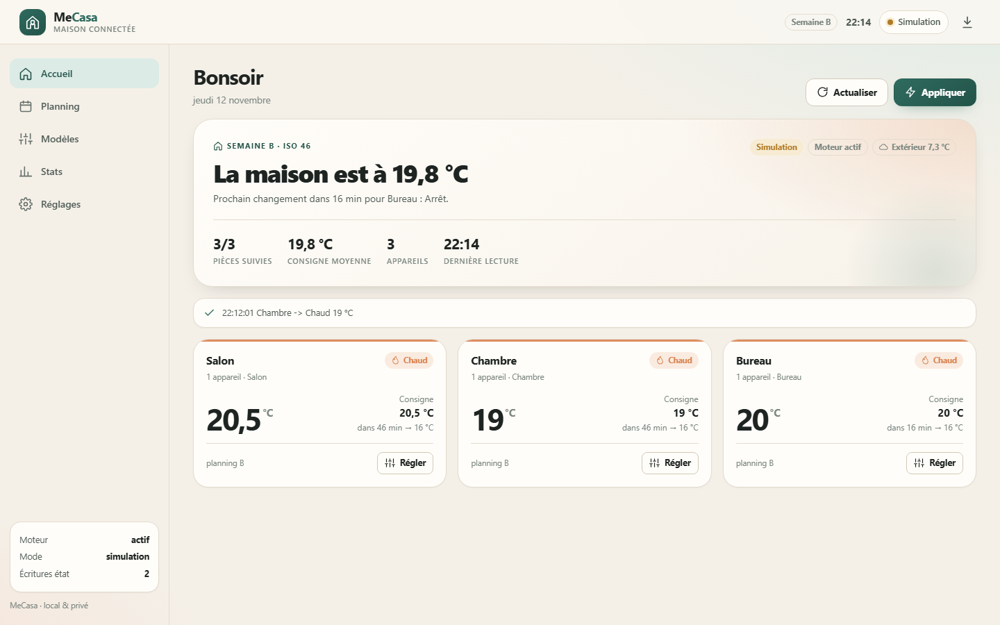
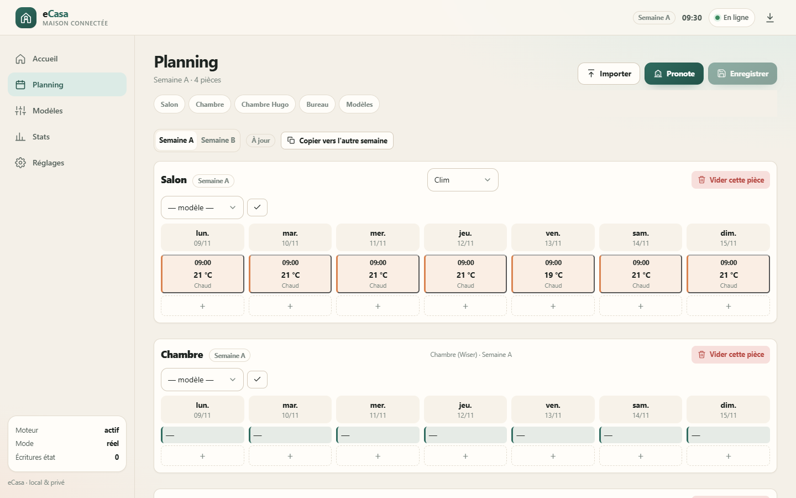
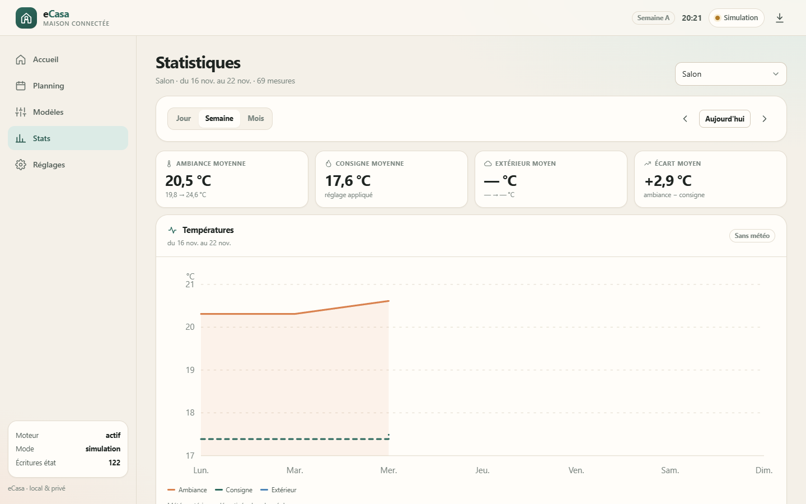
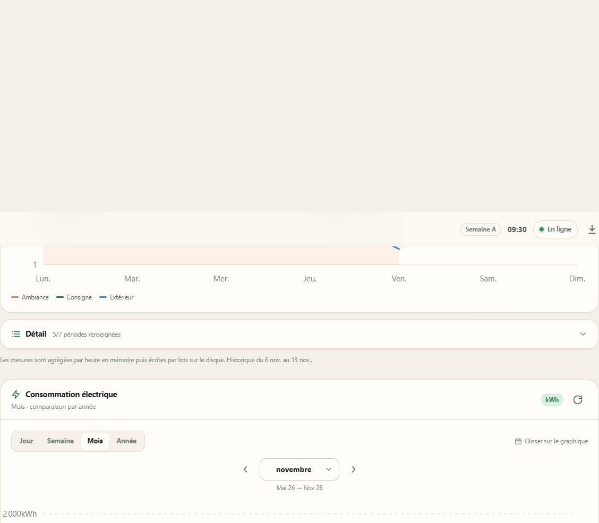
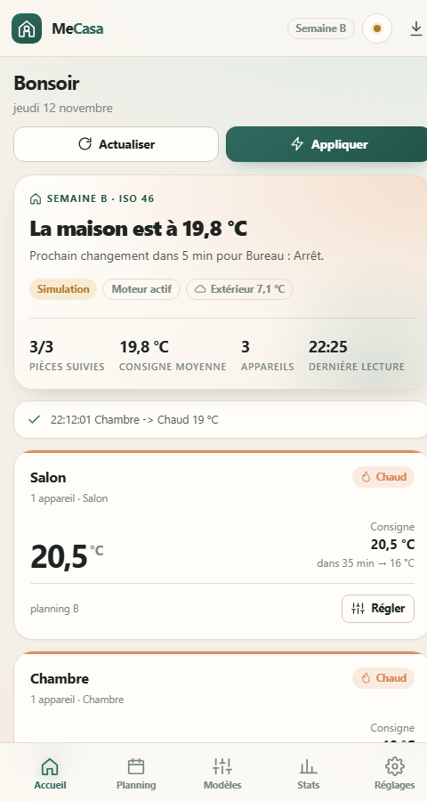

# MeCasa

**Le chauffage et la climatisation de la maison, pilotés localement, sans cloud et sans usure de carte SD.**

MeCasa est une application web auto-hébergée qui gère le chauffage (Atlantic / Cozytouch,
Schneider Wiser) et la climatisation, avec un planning hebdomadaire, des semaines A/B,
un import **Pronote** natif et un moteur qui applique tout seul les bonnes consignes.

[](LICENSE)
[](https://www.python.org/)
[](requirements.txt)
[](docs/installation.md)

> **Essayer en 2 minutes, sans matériel.** Windows : double-clique sur **`run.bat`**.
> Linux / Raspberry Pi : `./run.sh`. Ouvre ensuite <http://localhost:8780>.
> MeCasa démarre en **simulation** avec des appareils fictifs : tu vois toute
> l'interface avant de brancher quoi que ce soit.

- **Rien à connecter pour commencer** : mode simulation intégré, sans compte Atlantic.
- **Rien à héberger ailleurs** : un seul processus, aucune base de données, aucun Docker.
- **Rien à payer** : gratuit, open source, sans compte en ligne ni télémétrie.

---

## Pourquoi MeCasa ?

- **Léger** : un seul processus Python, bibliothèque standard uniquement. Pas de Docker,
  pas de base de données, pas de npm. Tourne très bien sur un Raspberry Pi zéro/3/4.
- **Écrit pour durer** : tout l'état vit en RAM, le disque n'est écrit que par lots
  (snapshot débouncé + historique horaire append-only). La carte SD ne s'use pas.
- **Pensé pour une vraie famille** : semaines A/B, garde alternée, planning Pronote
  importé automatiquement, jour d'alternance lundi ou vendredi, import partiel qui ne
  touche jamais au reste de la journée.
- **Sobre et sûr** : aucune télémétrie, aucun compte en ligne, CSP stricte, secrets
  jamais renvoyés au navigateur, administration limitée à la machine locale par défaut.
- **Utilisable au quotidien** : interface mobile-first installable (PWA), thème clair/sombre,
  application Android en préparation.
- **Simple à installer et à prendre en main** : deux commandes, aucune dépendance à
  installer, aucun build, aucun compte à créer. L'interface se comprend en quelques
  minutes, sans jargon ni formation.

## Fonctions

| Domaine | Ce que fait MeCasa |
| --- | --- |
| **Chauffage Atlantic** | Connexion au compte Cozytouch, consignes confort/réduit/hors-gel, modes, forçages temporaires. |
| **Climatisation Atlantic** | Modes chaud/froid/déshumidification/ventilation, soufflerie et orientation du flux appliquées à chaque cycle. |
| **Schneider Wiser** | Découverte du hub sur le réseau local, lecture des plannings, import dans MeCasa. |
| **Planning** | Agenda 24 h par pièce, créneaux tactiles, modèles de semaine, copie A↔B, surcharges. |
| **Pronote** | Import des semaines A et B, mise à jour quotidienne à l'heure choisie (ou désactivée), gestion de la garde alternée. |
| **Météo** | Température extérieure Open-Meteo, sans clé d'API. |
| **Statistiques** | Ambiance / consigne / extérieur, consommation électrique Enedis multi-années. |
| **Journal** | Événements filtrables, recherche, export JSON. |
| **Sauvegarde** | Export/import complet de l'état et des réglages. |
| **Accès distant** | Tailscale intégré (HTTPS, MagicDNS) et application Android (à venir). |

## MeCasa, Home Assistant et Jeedom

MeCasa n'est **pas** une plateforme domotique généraliste : c'est un outil spécialisé,
volontairement petit, pour le chauffage/clim et le planning familial. (Joomla est un CMS
web, sans rapport avec le pilotage thermique.)

| Critère | **MeCasa** | Home Assistant | Jeedom |
| --- | --- | --- | --- |
| Installation | Python + `python -m mecasa.main` | OS/Docker, assistant complet | LAMP/Docker + plugins |
| Empreinte | Quelques dizaines de Mo de RAM | 1 à 2 Go de RAM | Plusieurs centaines de Mo |
| Dépendances | Bibliothèque standard | Nombreuses intégrations | Plugins tiers (parfois payants) |
| Pronote | **Natif** (planning → chauffage) | Intégration communautaire | Plugin tiers |
| Semaines A/B + garde alternée | **Natif** | À construire soi-même | À construire soi-même |
| Wiser / Atlantic | **Natif** (hub local + Cozytouch) | Intégrations | Plugins |
| Écriture disque | Optimisée carte SD | Variable selon l'installation | Variable |
| Courbe d'apprentissage | Quelques minutes | Plusieurs heures | Plusieurs heures |
| Écosystème domotique | Volontairement absent | **Très riche** | Riche |
| Automatisations générales | Non (planning thermique uniquement) | **Oui, très puissantes** | Oui |

**En résumé** : choisis Home Assistant ou Jeedom si tu veux piloter toute la maison
(Zigbee, alarme, médias…). Choisis MeCasa si tu veux une chose simple qui marche :
chauffer la bonne pièce au bon moment, suivre le planning de l'école et ne plus y penser.

## Un projet écrit avec l'aide d'une IA

MeCasa a été **conçu et développé avec l'aide d'une intelligence artificielle**, au
service d'un besoin très concret : piloter le chauffage d'une maison avec le
planning scolaire de l'enfant. L'IA a écrit le code, les tests et la documentation ;
le pilotage du produit, les choix techniques et les essais sur matériel réel restent
humains.

Ce qui en découle, et qui te concerne directement :

- **un code lisible et reproductible** : pas de boîte noire, pas de service caché,
  tout est lisible, commenté et modifiable ;
- **une base de tests solide** : le moteur, le planning, les connecteurs et la
  synchronisation quotidienne sont couverts par des tests unitaires ;
- **des évolutions discutées avant d'être codées** : chaque proposition est lue,
  commentée, puis implémentée si elle simplifie vraiment l'usage.

### Tes suggestions sont les bienvenues

MeCasa n'est pas figé. Les idées les plus utiles pour la suite :

- **d'autres systèmes et appareils** : Daikin, Bosch, Netatmo, HP WebOS,
  Fritz!DECT, Zigbee, Z-Wave, Connected Home… ;
- **d'autres usages** : volets, pilotage de PAC, consignes par pièce, export
  iCal/ICS du planning ;
- **d'autres intégrations** : MQTT, Home Assistant (via son API REST), Jeedom,
  Alexa, Google Home ;
- **encore plus de simplicité** : un assistant de configuration, des modèles de
  planning prêts à l'emploi, moins de réglages à retenir.

Ouvre une **discussion** ou une **issue** : chaque proposition est lue et peut
finir en contribution.

## Feuille de route

- **Application Android** : une application native d'**accès direct à l'app**, en
  complément de la PWA actuelle — ouverture instantanée de MeCasa, notification
  quand le planning Pronote a été mis à jour, forçage du chauffage en un geste,
  alertes de l'état de la maison.
- **Nouveaux connecteurs** d'appareils et de systèmes (voir les suggestions ci-dessus).
- **Export du planning** au format iCal/ICS pour les agendas du téléphone.
- **Mode hors ligne** de l'interface (consultation du planning sans réseau).

## Démarrage rapide

Des **scripts fournis** font tout : démarrage, arrêt. Sans identifiants Atlantic,
MeCasa démarre en **simulation** avec des appareils fictifs — on découvre toute
l'interface avant de brancher quoi que ce soit.

### Windows

1. Récupérer le dépôt (`git clone`, ou télécharger l'archive et la dézipper).
2. Double-cliquer sur **`run.bat`**.
3. Ouvrir <http://127.0.0.1:8780>.

Pour arrêter : double-cliquer sur **`stop.bat`**.

### Raspberry Pi / Linux / macOS

```bash
git clone https://github.com/shervet/mecasa.git
cd mecasa
./run.sh
```

Pour arrêter : `./stop.sh`.

Installation en service (démarrage automatique, résistant aux coupures) :

```bash
sudo ./install-pi.sh
```

Les scripts utilisent le Python du projet (`.venv`) s'il existe, sinon celui du
système. Si tu préfères la ligne de commande, `python -m mecasa.main` fonctionne
aussi — voir [docs/installation.md](docs/installation.md).

Guide détaillé : [docs/installation.md](docs/installation.md).

## Documentation

| Document | Contenu |
| --- | --- |
| [Installation](docs/installation.md) | Windows, Linux, Raspberry Pi, systemd, PWA, mise à jour, sauvegarde. |
| [Configuration](docs/configuration.md) | `config.json`, réglages de l'interface, secrets, réseau, stockage. |
| [Pronote](docs/pronote.md) | Compte, import, semaines A/B, garde alternée, mise à jour automatique. |
| [Équipements](docs/equipements.md) | Atlantic/Cozytouch, climatisation, Wiser, pièces et appareils. |
| [API HTTP](docs/api.md) | Toutes les routes JSON et les règles de sécurité. |
| [Dépannage](docs/depannage.md) | Symptômes courants et solutions. |
| [Dons](docs/donations.md) | Soutenir le projet, et comment recevoir des dons avec un minimum de frais. |

## Captures d'écran

| Accueil | Planning | Statistiques |
| --- | --- | --- |
|  |  |  |

**Consommation électrique** — comparaison des mêmes périodes d'une année sur l'autre,
via MyElectricalData (Enedis) :



**Réglages → Pronote** — compte, statut scolaire, pièces liées, jour d'alternance et
mise à jour automatique :


Et l'application installée sur téléphone (PWA, installable depuis le navigateur) :



> Captures prises sur une instance de **simulation** : aucune donnée personnelle.

## Sécurité et vie privée

- Aucune dépendance sortante en dehors des services que **tu** configures
  (Atlantic, Wiser, Open-Meteo, Pronote, Tailscale, MyElectricalData).
- CSP stricte, aucun script inline, aucun CDN.
- Les routes d'administration sont bloquées depuis le réseau par défaut
  (`allow_remote_admin: false`).
- Les mots de passe et jetons ne sont jamais renvoyés à l'interface.
- Pour l'accès distant, préférer **Tailscale** à l'ouverture d'un port sur la box.

Voir [SECURITY.md](SECURITY.md) pour signaler une vulnérabilité.

## Contribuer

Les contributions sont bienvenues : corrections, traductions, documentation, tests sur
matériel réel. Lire [CONTRIBUTING.md](CONTRIBUTING.md) avant d'ouvrir une pull request.

Tu as une idée d'évolution — nouvel appareil, nouvelle intégration, application
Android, encore plus de simplicité ? **Ouvre une discussion** : les suggestions sont
les bienvenues, et chaque proposition est étudiée avant d'être codée.

```bash
python -m unittest discover -s tests -v
```

## Soutenir le projet

MeCasa est gratuit, sans publicité et sans télémétrie. Si l'outil t'aide, un don
ponctuel ou récurrent finance le matériel de test et le temps de développement.

[](https://github.com/sponsors/shervet)

- **GitHub Sponsors** (0 % de frais) : <https://github.com/sponsors/shervet>
- Bouton **Faire un don** dans **Réglages → Soutenir**.
- Guide complet (frais, démarches, fiscalité) : [docs/donations.md](docs/donations.md).

## Licence

[MIT](LICENSE) — utilise, modifies, redistribues, y compris commercialement, en
conservant la mention de copyright.
